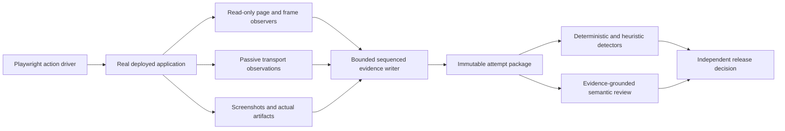

# DOM Capture Architecture

Status: DESIGN, NOT IMPLEMENTED. Version: 0.5. Date: 2026-09-12.
Serialization and evidence-health rules: [03-evidence-contract.md](03-evidence-contract.md).

## Objective

Capture enough of the real deployed experience to reconstruct what the user could
see and do, including transient failures, without materially changing that experience.
Optimize by avoiding redundant expensive reads, not by discarding inconvenient states.

| ID | Requirement |
| --- | --- |
| CAP-01 | Attach before the first evaluated action and follow every relevant document/frame lifecycle. |
| CAP-02 | Preserve ordered changes independently of known detectors. |
| CAP-03 | Observe DOM, layout, paint, focus, scrolling and media through complementary channels. |
| CAP-04 | Use bounded, measured capture work and loss-detecting transport. |
| CAP-05 | Keep the recorder read-only with respect to application state and network outcomes. |
| CAP-06 | Fail qualification on material blind spots or uncalibrated observer overhead. |
| CAP-07 | Never open/focus a user window or move the operating-system pointer. |

## Components and Ownership

The driver performs normal user actions and records action intent/outcome. It does
not write expected results into stores. The recorder observes, never repairs or
stabilizes the application. Evaluators own meaning, pairing, normalization and verdicts.

Reuse Playwright/browser primitives and the existing hidden runner. Do not introduce a
second app instance, fixture route or local frontend into deployed qualification. The
recorder can run within a dedicated browser context; it must never attach to the user's
personal browsing profile or repurpose their windows.

## Mandatory Per-Flow Capture Design

Every task flow must have an explicitly authored, reviewed and versioned capture design
before its qualifying run. This architecture is shared infrastructure, not that design.
A generic page recorder, automatic relevance selection or runtime agent decision cannot
substitute for specifying what evidence each step and variant requires.

The design names the flow/case version, phases and branches, semantic regions and their
selector/identity contracts, detailed/context/abstract representations, retained fields,
timestamped mutation channels, geometry/paint cadence, checkpoints, dependency boundaries,
privacy exclusions, resource ceilings and insufficiency conditions. Each choice traces
to the step's user expectation and the evidence needed to judge it. Requirements and the
design are frozen before execution; the run manifest binds their versions and digests.

Resolution changes are a predesigned state machine: for example, the flow specifies that
the image viewer becomes detailed before its Open action and stays detailed through
loading, error or success, interaction and dismissal. Runtime work resolves actual node
IDs and executes those declared transitions. It does not decide what is worth capturing.
Shared profiles may be reused, but each flow must explicitly bind them and demonstrate
that all of its expectations and variants are observable. See the capture-design template
in [04-task-flow-coverage.md](04-task-flow-coverage.md).

Preflight must reject a missing, stale or incomplete per-flow capture design before the
qualifying action starts. Discovery runs may help author the design, but their evidence
is labelled discovery and cannot retroactively become qualification for a plan invented
afterward. The current seed catalog has not yet supplied these per-flow designs.

### Driver and Observer Must Not Hide Each Other's Failures

Install the declared observers and verify their health before the first evaluated
action. Record before calling a Playwright action, throughout its actionability waits,
scrolling and retries, and after it resolves or throws. A successful `locator.click()`
proves a click eventually happened, not that the control was promptly visible, reachable
or stable beforehand. Preserve automatic driver scrolling as a separate cause from
spontaneous product scrolling; never use it to certify the original viewport.

No `force` clicks, synthetic DOM clicks, arbitrary state injection, implicit reload-to-fix,
or wait-until-correct-before-capture. Retrying an assertion does not erase earlier frames.
Record the bounded readiness/action deadline from the expectation, not merely the tool's
default timeout. Even on an action timeout, finish the bounded evidence flush and retain
the failed attempt; do not skip its remaining failure evidence.

Capture-phase transitions use the flow's predeclared action/lifecycle triggers, independent
of the evaluator's pass/fail decision. Do not start streaming capture only when a reply
is correctly positioned, or stop because an app label says done. Pending, wrong-state,
error, cancellation and reconciliation branches must have planned capture coverage.
End high-resolution observation only at the specified terminal plus reconciliation
conditions, or at a recorded deadline. A deadline is not a stable-success state.

## Observer Topology Is Part of the Flow Design

A compact JSON output does not imply a cheap recorder. Browser observer delivery,
old-value copies, hashing and layout reads cost resources before serialization. Each
flow design must specify which observers attach to which roots in each phase, including
attribute/old-value policies and dependency invalidation.

- Use the coarse document sentinel for structural discovery and declared global effects;
   do not turn on full character-data/attribute old-value capture over the entire body.
- Detailed regions get only the channels and old values needed for their declared
   reconstruction. Redacted credential regions must never enter text-value capture.
- Context/abstract regions retain their declared boundary/activity observations without
   recursively walking, hashing or copying all descendant text after every mutation.
- Ancestor class/style, theme/font, portal, CSS-only animation and scroll dependencies
   need explicit observers or sampling. Narrow observation cannot silently lose effects
   outside its subtree. Missing support for a required effect blocks that profile.
- Measure old-value copying and text-diff work on long streaming replies. Text splices
   reduce stored bytes but do not automatically remove browser-side quadratic work.
   If required precision cannot be retained within budget, record the unsupported size;
   do not silently drop text transitions or discard old-value evidence.

During topology changes, drain and sequence pending records, retain node identities and
record observer installation/removal times. Deduplicate only demonstrated duplicate
delivery from overlapping observers, never two genuine same-value mutations. Any blind
interval is explicit. A phase switch is not permission to clear a queue of inconvenient
records or to reclaim past omitted detail.

## Surface Discovery

### What Resolution Means

Capture resolution is the smallest distinction retained in a region of the recorded
experience. It is a vector of independent choices, not one global frame rate or a
requirement to serialize every DOM node:

| Axis | Higher resolution | Lower resolution |
| --- | --- | --- |
| Structural | Individual message/control/text-block identities, parent/sibling relationships and changes | One abstract record for an entire unrelated subtree |
| Content and state | Safe exact text edits, control values/states, accessibility and relevant style attributes | Region identity, selected summary fields and declared omitted descendants |
| Temporal | Ordered mutation batches and delivered-frame layout samples throughout a critical transition | Timestamped boundary/activity changes and sparse checkpoints for unrelated stable regions |
| Geometry and paint | Per-relevant-element rectangles, clipping dependencies, hit targets and targeted visual evidence | Region boundary geometry and visibility, with broader screenshot context when needed |

Temporal resolution includes timing uncertainty: mutation delivery timestamps are not
precise mutation-occurrence times. Pixel resolution and screenshot cadence are separate
parameters of the paint channel. Neither defines the structural resolution of the JSON.

The same recording deliberately mixes resolutions. Fine structural detail does not
require every available computed style; a high-frequency order trace does not require
repeating full message text. Choose the minimum representation that can answer the
declared user-experience questions, retaining enough context for unexpected effects.

### Local Detail and Subtree Abstraction

The capture tree is a projection of the DOM, not a copy of it. The per-flow design
partitions the app into semantic regions and assigns these levels to every declared
phase before execution:

| Level | Example during chat submission | Representation |
| --- | --- | --- |
| Detailed | Composer, submitted prompt, current reply, tool/result/error surfaces | Stable meaningful nodes, exact safe content/state changes, sequence and transition geometry; flatten incidental wrappers while retaining their effective layout/visibility dependencies |
| Context | Conversation sequence, nearby messages, header and scroll/clip ancestors | Ordered message identities and anchors, relevant aggregate state and boundary geometry; no repeated traversal of every markdown span in old history |
| Abstract | Unused history-sidebar contents or an unrelated closed panel | One region record with identity, parent/position, bounds, observed visibility/activity, omitted detail and reason; no descendant serialization |

An abstract region is not absent, empty or known-correct. It can still resize, move,
overlay the task, receive focus or be removed. Retain those boundary effects and a
timestamped activity/invalidation marker when internal changes might affect relevance.
Do not compute a recursive subtree hash, text dump or exact descendant count on every
mutation just to populate a supposedly cheap summary. Use already-known safe summaries;
unmeasured internals remain explicitly unknown.

Resolution selection is expectation-led and fixed by the per-flow design. Freeze the
region assignments for each phase and the permitted transitions, not just a broad rule
to "capture more when relevant." The runner may execute those transitions, never invent
a new phase, field selection or abstraction policy to keep a run passing.

Declare promotion before actions and for expected output, focus, alert/dialog/overlay
and layout-dependency branches. Include required ancestor/sibling/scroll dependencies
rather than blindly expanding the whole page. A separately predesigned document-wide
sentinel must notice unexpected regions outside detailed roots. Its fixed fallback may
retain bounded diagnostic context, but an unplanned relevant surface is a capture-design
gap: preserve evidence, revise the design and qualify a new attempt. Do not dynamically
expand the current attempt and claim the missing earlier phase was covered.

Each promotion records a timestamp, reason, old/new profile and a new subtree checkpoint.
It observes detail from that point forward; it cannot recover omitted earlier internals.
If those earlier internals are required to judge the task, the attempt has insufficient
evidence and the next attempt starts with that region promoted. Never fabricate a zoomed-in
past. Demote only at the phase and quiescence conditions specified in that flow's design;
do not discard earlier detailed evidence.

If a required region cannot be captured within budget, stop qualification rather than
downgrade its detail invisibly. Keep unknown impact explicit until observed. Abstraction
is intentional information reduction; compression of the retained representation is
lossless. Do not promise reconstruction of the entire original DOM from abstract regions.

Start with an initial document checkpoint and a semantic inventory: shell, navigation,
composer, message groups, tools, results, overlays, forms and lists. Include layout and
visibility ancestors, portal roots, open shadow roots and same-origin frames. Discover
new surfaces when inserted; do not rely on a fixed set of selectors selected for one bug.

Stable domain IDs and accessible roles/names identify product meaning. Recorder node
IDs identify DOM lifetimes. CSS selectors are implementation locators only. Keep these
identities separate so duplicate IDs, remounts and optimistic/server handoffs are visible.

Large/offscreen structures use abstract/context records and selective subtree checkpoints
with ordered deltas; they do not require a per-descendant capture registry.
The manifest declares exactly which roots and fields were captured. Offscreen does not
mean irrelevant: retain message presence/order and inspect offscreen controls by normal
scrolling when their flow calls for it. Closed shadow roots, inaccessible frames and
virtualized content are declared capabilities or gaps, not silently flattened to empty.

For cross-origin CIAM, observe only allowed authentication outcomes and safe shell
state. Do not bypass origin restrictions or collect credential form values. Browser
frame APIs may provide safe visible evidence where permitted; otherwise mark unavailable.

## Capture Schedule

| Trigger | Work and evidence |
| --- | --- |
| Before navigation | Install observer bootstrap for eligible app documents; record expected origin and capture policy. |
| Document commit | New document ID, capability check and initial checkpoint; record observer installation gap if any. |
| Before/after user action | Action ID, target identity, focus/viewport state, immediate state checkpoint; screenshot when visually material. |
| DOM mutation | Immediately record ordered detail for detailed/context fields; abstract regions emit declared boundary/activity records instead of descendant payloads. Timestamp both and defer expensive layout reads. |
| Animation frame during transitions | Sample relevant geometry, order, visibility, scroll, focus and active animations once per delivered frame callback. |
| Resize, scroll, font/media load, theme change | Invalidate affected layout roots and record events; sample geometry even without DOM changes. |
| Network/run event | Record permitted real request/response/event metadata independently of DOM timing. |
| Overlay/result/error opens | Start a bounded transition capture window, acquire paint evidence and later test settled interaction. |
| Quiescent state | Periodic health checks and recovery checkpoint; stop high-frequency geometry only when the declared state is stable. |
| Reload, pagehide, crash, close | Flush/checkpoint if possible; runner marks interrupted streams and retains incomplete evidence. |

Use MutationObserver for DOM records, ResizeObserver for box invalidation, scroll/focus/
input/lifecycle events, requestAnimationFrame for transition sampling, and passive
Playwright network/media events. Retain native events without fabricating server events.

Mutation callbacks batch changes and run after script execution; they are not a hook
into every React commit or every historical geometry state. RequestAnimationFrame
callbacks occur before paint and can pause when hidden. Screenshots and video have
their own timing and may skip intermediate paints. None alone guarantees every physical
display frame. Record each channel's capabilities, timings and omissions explicitly.

The invariant still applies to every user-visible state. Supplement real-app evidence
with separately labelled deterministic every-commit tests and recorder calibration.
Those tests do not substitute for deployed evidence. If the incident requires a temporal
resolution this browser cannot establish, the requirement remains unqualified.

## Efficient Observation

### Information Selection, Not Just Compression

The recording is a time-indexed, replayable account of the task flow: a "JSON video"
of observed DOM and related visible state, not a sequence of final screenshots or
pass/fail summaries. Optimization has two separate tests: bounded cost and preservation
of the information needed to discover failures. Small files alone are not success.

Freeze a capture-profile version before the run. It declares roots, node/field classes,
detail levels, exclusions and rationale. Select for user-observable effect, not whether
a known detector currently uses the field or whether a change looks normal.

| Detail level | Retain | Reduction allowed |
| --- | --- | --- |
| Interaction and result surfaces | Task inputs, actions, prompts/replies, progress, errors, artifacts, focus and accessibility state; every observed relevant change | Stable content references and lossless text patches; no time debouncing of mutations |
| Layout and visibility dependencies | Parent/sibling order, scroll containers, ancestors affecting layout/paint, portal/overlay roots, relevant class/style/attribute changes and frame geometry | Cache unchanged values; compute style/geometry once per dirty root per frame |
| Surrounding context | Navigation, route, visible neighboring content and offscreen conversation identity/order | Initial snapshot plus changes; offscreen expensive paint sampling only when required or approached by scrolling |
| Static/redundant implementation material | External bundle/style/font/image bytes and static assets | Reference once by permitted identity/digest; do not embed their bytes in every DOM record |
| Non-evidence or protected payloads | Script source, unchanged stylesheet bodies, framework-private objects, duplicate base64 payloads, secrets | Exclude payload under a declared rule; preserve relevant structure/load/error/identity and computed effects |

CSS source need not be copied on every mutation, but its effects cannot be excluded.
Similarly, decorative media may affect clipping, contrast or occlusion even when its
full bytes are not repeated. User-requested source code or a document is output evidence,
not excluded merely because its content resembles implementation material.

Observe document-wide structure/lifecycle through the flow's declared sentinel so newly
inserted overlays, alerts, portals and results are noticed outside the initial task root.
Expected surface classes use their predesigned capture transitions; unplanned relevant
surfaces follow the diagnostic-and-replan rule above. Never ignore a removed/hidden node
because it no longer appears visible. Preserve discovery time and blind spots instead of
letting an allowlist hide unexpected behavior or an improvised rule manufacture coverage.

Exclusion entries record rule/version, affected surface/field class, reason and count.
Protected fields remain redacted, with any resulting qualification gap explicit. A
change that can affect order, meaning, paint, interaction, progress, errors, focus or
ownership is not disposable detail. Capture enough surrounding state to diagnose why.

### Sampling and Encoding

1. Read structural/text changes in the mutation callback without walking the whole DOM
   or calling layout APIs for every token. Preserve before-values and removed-node data
   where the browser exposes them; do not invent missing historical values.
2. Maintain a node registry and dirty-root queue. Deduplicate scheduling work, not event
   history. Structural sibling changes always invalidate the containing sequence.
3. Batch computed-style and geometry reads in one sampling phase. Invalidate ancestors
   for inherited styles, font loads, transforms, overflow, layout changes and themes.
4. Sample layout and animation even if no DOM mutation occurs. A translated or clipped
   message is a visual change, not an unchanged frame because its text hash is stable.
5. Cache immutable content by SHA-256. Stream ordered deltas to the runner in batches,
   with acknowledgement, sequence accounting and checkpoint recovery.
6. Deduplicate identical screenshots/content losslessly. Retain timestamps and sequence
   ranges for repeated frames. Perform compression and expensive analysis outside the
   app page; do not embed semantic evaluators in the render path.
7. Store safe raw observations as well as derived representations. Reconstruction and
   new-detector replay must not depend on assumptions made by the first detector.

For a streaming reply, store its initial text once, then observed insert/delete/replace
splices and occasional recovery checkpoints. Do not repeatedly serialize the whole
growing answer. Append-only assumptions are forbidden: revisions, retractions and
replacement text must also reconstruct correctly. Keep raw mutation semantics and
derived move/text-patch encodings distinguishable.

Within the retained field profile, transport batching is not temporal debouncing: ten
changes sent in one packet remain ten ordered events with their original observation
metadata. A -> B -> A is never reduced to "unchanged". An abstract region's omitted
internal transitions are declared as such, not misrepresented as fully recorded detail.

### Proving the Optimization

Qualify each capture-profile change with:

- Replay equivalence: reconstruct the declared fields at every recorded checkpoint and
   transition without executing app scripts or contacting any service.
- Critical-detail calibration: inversion/correction, hide/restore, remount, CSS-only
   clipping, overlay outside the task root, text retraction and focus theft remain visible
   to the same detectors under the optimized profile.
- Exclusion counterexamples: demonstrate that each omitted payload class retains its
   relevant visual/behavioral effects; remove the exclusion if this cannot be shown.
- Local-resolution calibration: unrelated subtree churn stays bounded without descendant
   dumps; opening that region promotes detail before interaction; a new overlay, focus
   change or boundary resize still triggers capture. Earlier abstract internals remain
   visibly unavailable in replay, rather than appearing as fictional detailed frames.
- Size/cost measurements: event count, bytes by channel, compression ratio, queue peaks,
   page-side p95 cost and measured action/frame perturbation at several history sizes.
- Failure accounting: any unsupported size, sequence loss, new unobserved surface or
   excessive overhead produces insufficient evidence, not an automatic switch to a
   thinner passing recording.

These checks establish adequacy for the declared profile, not a universal optimum or
complete observation of all browser internals. Richer reference capture in recorder
calibration is useful for comparison; it is not mocked-product release qualification.

No per-token full-page screenshot, full-DOM serialization, remote reviewer call or
synchronous filesystem/network write in the page. No screenshot-only gate. Do not
disable animation, hide flaky elements, replace fonts, force-click covered controls
or wait until a transient defect disappears before starting the recorder.

## Paint and Operability

DOM geometry supports diagnosis but does not prove paint. At required checkpoints:

- Capture screenshots with actual production fonts, icons, CSS, images and media.
- Check font-load outcomes and expected glyph paint, not merely CSS font-family values.
- Check image decode/error and natural dimensions, then inspect the rendered subject.
- Check clipping intersections through ancestors, opacity/visibility inheritance,
  transforms, sticky/fixed layers, inert/disabled state and modal occlusion.
- Sample hit targets inside the visible intersection; never clamp an offscreen center
  into the viewport and call it evidence of clickability. Use real locator actions.
- Check focus path, return target, selection and accessible semantics through browser
  APIs; label text fallback is not an accessible-name algorithm.
- Use actual canvas/media screenshots when DOM cannot describe pixels. Tainted-canvas
  read restrictions must not be bypassed or mistaken for a blank image.

Visible does not always mean interactive: progress text may be non-interactive, and a
disabled Save button may be correct while saving. Detectors apply the flow's expected
state. Scroll position and virtualized history require explicit task-specific interpretation.

Preserve the existing `msg-in` entrance behavior. Record animation timing and opacity.
Any exception for its initial zero-progress state must be narrow, documented and tested
against later disappearance; it must not waive prompt-before-response or remount failures.

## Proposed Budgets and Calibration

These are starting engineering targets, NOT measured or approved performance results.
They must be calibrated on supported browser/environment profiles before qualification.

| Resource | Initial proposal | When exceeded |
| --- | --- | --- |
| Page-side work | At most one geometry read batch per delivered frame; target p95 <= 2 ms at the declared DOM size | Stop issuing new scenario actions, preserve samples and mark observer perturbation unqualified. |
| Timing perturbation | Target <= 5% median action/render latency increase in paired recorder-off/on calibration | Investigate scheduling or reduce redundant work; never reduce required evidence silently. |
| Event transport | Flush at 64 KiB or 100 ms, whichever first; bounded 8 MiB page queue | Record overflow/unknown range; abort qualification rather than drop required changes. |
| Recovery | Checkpoint every 2 seconds during activity plus navigation boundaries | If checkpoint exceeds its cost budget, declare the unsupported surface size; no hidden truncation. |
| Screenshot load | Before/after material actions and visual milestones; proposed bounded transition bursts up to 5 fps | Preserve all DOM/frame samples; declare paint-resolution limits and stop if required paint coverage is unavailable. |
| Scenario artifacts | Default proposed 250 MiB and explicit wall time; limits declared before run | Close the run as incomplete; retain existing evidence and stop new model work. |

Capture windows follow observed loading, streaming, movement and reconciliation, not
only fixed sleeps. Long-open/background cases have separate phase budgets and explicit
visibility timelines. A 200-500 ms idle health poll is a safety net, never the chronology
sampler. There is no promise that screenshot bursts see every painted frame.

Calibration uses small/large histories, rapid token updates, CSS-only motion, overlays,
scrolling and delayed transport. Measure callback cost, long tasks, frame intervals,
input latency, artifact volume and overflow behavior. Use deterministic recorder tests
to establish loss detection, then matched real-product measurements for perturbation;
generated response variability alone is not an overhead benchmark.

Changing budgets or support limits requires a new capture-policy version and matching
evidence. Do not weaken a threshold retrospectively to make a failed run pass.

## Recorder Qualification

Before trusting this recorder, independently test that it detects or explicitly marks:

- Prompt inversion, removal/reinsertion and visibility hide/restore within a transition.
- CSS-only displacement, clipping, transparent ancestors and obscured click targets.
- DOM-ID reuse, remounts, duplicate domain IDs, nested frames and navigation replacement.
- Font failure, broken image with `complete=true`, blank canvas and wrong artifact bytes.
- Mutation storms, queue overflow, disk/transport failure, dropped sequences and crashes.
- CSS entrance motion without misclassifying every legitimate initial frame.
- Background frame suppression and uncertainty between a screenshot and DOM checkpoint.
- Secret-bearing inputs/network fields excluded before artifact persistence.

Deliberately injected defects belong to a separate recorder-calibration suite. They are
not evidence that the unmodified deployed product passed. First implementation must
demonstrate capture and offline detection of one real deployed incident before expanding
into a general-purpose recorder framework.